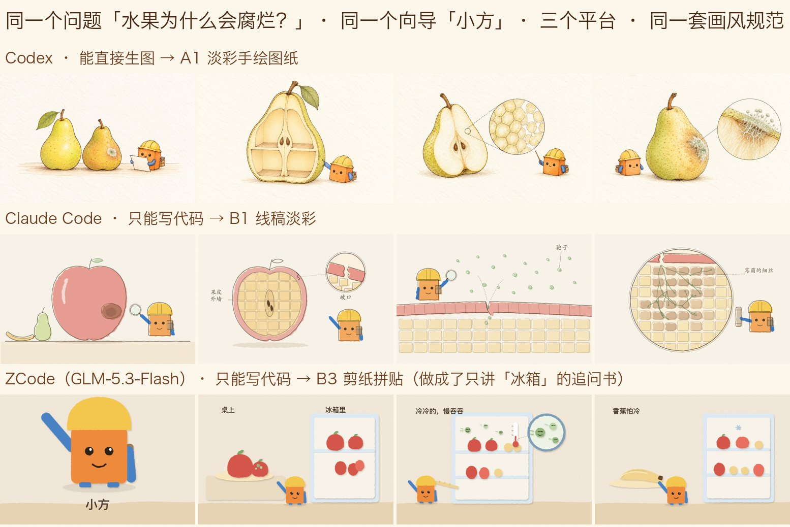

# 好奇心工地 · curiosity-site

**家长借 AI，把 3–6 岁孩子的「为什么」接住、讲清楚、讲对。**

> 「我做这个 skill 的意义，是让孩子和家长一起共同探索孩子的问题，然后通过一种科学的方式，并且是以孩子能理解的方式，把这个问题回答掉。目前选择的回答载体是绘本。」
> ——作者，一位建筑师父亲

这是一个开源的 Agent Skill。它不是一个做绘本的工具，而是一种**家长和孩子一起探索问题的方法**，写成了任何 agent 都能照着跑的说明书。装进 Claude Code、Codex 或 ZCode 就能用。

## 一个家庭怎么用它

```
孩子问：「水果为什么会腐烂？」
   ↓
① 先接住：agent 给家长一两句现在就能说的真回答，和一个现在就能做的小动作
   （一句话答得清、孩子满意了，就到此为止，不是每个问题都要做成书）
   ↓  孩子追着问，或者家长想讲透
② 做书：agent 查证 → 按孩子的年龄档、用家长熟悉的比喻分三章讲 → 孩子自己的向导角色带路
   ↓
③ 家长审核：看家长卡（来源、拿不准的地方、敏感提示），说可以才算数
   ↓
④ 一起读：家长读给孩子听，在共读卡标的地方停下来问「你猜呢？」
   ↓
⑤ 孩子说出新的问题 → 回到 ①
```

**对孩子最大的肯定，是他问完以后得到一个让他满意的回答。** 不靠夸他聪明，靠认真答到他满意。



> 同一道题「水果为什么会腐烂？」、同一个向导角色「小方」，在三个 agent 上跑出的书。能生图的 Codex 画成淡彩手绘图纸，只能写代码的 Claude Code、ZCode 用 SVG 画成线稿淡彩和剪纸拼贴。**出图的形式不同，审美按同一张风格卡来控制**（`references/08_画风.md`）。
> 成品在 [`examples/`](examples/)：下载 `book.html` 双击就能翻，断网也能看，每页可以用「晓晓」的声音朗读。今天上午的第一版存在 `examples/第一版/`，两版放在一起，能看出这套方法当天是怎么迭代的。

## 为什么做

2026 年 1 月到 6 月，一个 4 岁半到 5 岁的孩子问了 73 个问题。他的爸爸是建筑师，每天把一个问题做成一本绘本讲给他听：先让 Gemini 写脚本，再交给 NotebookLM 做成书，下载下来讲。四个工具接力。

做了 60 多本，看到三件事：

1. **好问题常常在读完之后才冒出来。** 听完圣诞节的故事，他问「圣诞老人会死掉吗」。旧流程里孩子只能问一次，书读完就结束了
2. **有的日子他说「我今天没有问题」。** 这也是一种回答，不该追着他要问题
3. **吸引他的是有个角色带路，但那些角色都是别人的**（某校车、某小火车）。不能公开分享，而且他自己描述的角色，他更在意：给他看照着他的描述画出来的角色，他会逐处指出「这里不像」

3–6 岁是问题最多的时候。回应得好不好，会影响孩子还愿不愿意继续问；而不同家庭给孩子「真解释」的比例差别很大。这个 Skill 想帮的，正是那些想好好回答、却不知道从哪讲起的家长。

## 设计依据

v0.2 的改版参考了一份儿童发展调研（34 个来源，包括教育部《3–6 岁儿童学习与发展指南》、世界卫生组织与联合国儿童基金会的指南、以及提问、共读、绘本学习方面的研究），全文在 [`docs/设计依据_儿童发展调研.md`](docs/设计依据_儿童发展调研.md)。几条关键结论：

| 研究发现 | Skill 里怎么做 |
|---|---|
| 孩子问「为什么」时要的是真解释；拿到了会满意或接着问，拿不到会再问一遍 | 先当场回应，再决定要不要做书 |
| 3 岁和 5–6 岁能听懂的句子、能跟上的步骤差很多 | 按小班（3–4 岁）、中班（4–5 岁）、大班（5–6 岁）三档定页数、字数、讲几步 |
| 边读边问、等孩子说，比书本身更能帮孩子学 | 每本书带一张共读卡，告诉家长在哪页停下来问什么 |
| 学龄前孩子怕的是「看起来吓人」，说「这不是真的」不太管用 | 任何题的画面都不画尖牙、怪脸、黑暗特写 |
| 大人说「我不知道」不会失去孩子的信任，乱猜说错了才会 | 给家长一句现成的话：「这个我也不知道，我们一起查」 |

## 一次真实的改版

ZCode 做的第一版里，小方的工具包背带画到了脸上。按流程，家长没有放行，而是提了意见：「孩子会说：小方脸上怎么有一道杠？像海盗。」另外指出一条来源没打开过、两条只写了网站首页。ZCode 按 Skill 里「家长要改」的步骤，保留原书、在新文件夹里改：只改角色代码里背带那一笔，七页同步替换；来源重新核对，打不开的删掉。


## 和「一句话生成绘本」有什么不同

| | 常见的 AI 绘本 | 好奇心工地 |
|---|---|---|
| 是什么 | 一个生成绘本的功能 | 一种家长和孩子一起探索问题的方法，绘本只是载体 |
| 追求 | 一句话出一本好看的书 | **朴实**：把问题讲清楚、讲对。先查证，家长卡写明来源和拿不准的地方 |
| 起点 | 直接生成 | 先当场接住孩子的问题；问一次需求（年龄、兴趣、怕什么、家长职业），存成家庭档案 |
| 角色 | 每次重新生成，或用现成卡通角色 | 家长和孩子**共创**一个向导角色；孩子本人也可以当主角 |
| 家长 | 不参与 | 审核内容、陪孩子读、边读边聊 |
| 结束 | 读完就结束 | 最后一页先请孩子自己说想知道什么；孩子的新问题进入下一轮 |
| 形态 | 一个封闭的功能或网站 | 一份开源工作流，在你已经在用的 agent 里跑，不用服务器，不用另配密钥 |

## 拆解法：结构固定，比喻按家长换

先走进去看 → 再看它怎么搭起来、怎么运转 → 最后回到生活。这个**顺序**是方法的骨架；**比喻**从家长的职业来：作者是建筑师，所以用梁柱、管道、工地；医生可以用诊室和检查，厨师可以用厨房和配方。

| 章 | 做什么 |
|---|---|
| 发现与走进去 | 从孩子看得见的现象开始，把东西放大，像走进一座房子 |
| 结构与它怎么工作 | 讲原理，一页只推进一步 |
| 魔法时刻与回到生活 | 最神奇的那一下，再连回孩子明天就能看到、能做的事 |

| | 小班 3–4 岁 | 中班 4–5 岁 | 大班 5–6 岁 |
|---|---|---|---|
| 正文页数 | 3–4 页 | 4–6 页 | 6–8 页 |
| 每页旁白 | ≤ 30 字 | ≤ 45 字 | ≤ 60 字 |
| 一本讲几步 | 1 步 | 2 步 | 2–3 步的因果链 |

## 三层规则：哪些能改，哪些不能改

| 层 | 管什么 | 能不能改 |
|---|---|---|
| **控制** | 安全与真实 | **不能改**。下面七条 |
| **引导** | 流程和格式：当场回应、问卷、三章结构、年龄档、共读卡、追问提示、角色卡、家长卡、反馈 | 结构固定，参数可以调（页数、字数、语言、比喻从哪个职业来） |
| **自由** | 情节、比喻、画风、角色长相，出图片、代码画还是视频 | 交给 agent 和这个家庭 |

### 七条硬规则，和它们的来历

| 规则 | 来历 |
|---|---|
| 1. **事实要查证**，来源只列真正打开核对过的；比喻和拟人可以用，但不能讲错 | 爸爸给孩子讲「银行怎么赚钱」时特别要求「要符合真实的经济规律」 |
| 2. **家长不放行，不交给孩子** | AI 写的东西，家长是最后一道关。未放行的书顶部有「家长预览版」横幅；它是提醒，不是锁 |
| 3. **敏感题按规则处理** | 「圣诞老人会死吗」「为什么男生女生不一样」这两题，旧流程里都是爸爸临时手工处理的；身体那题第一版画面根本生不出来，被迫重写 |
| 4. **AI 不扮演孩子的朋友或陪伴者**：不以向导的身份和孩子聊天；家长卡写明「由 AI 生成，家长看过才算数」 | 向导是故事里的角色，讲完就退场。陪伴是家长的事。和联合国儿童基金会的《AI 与儿童指南》一致 |
| 5. **不用任何现成 IP 角色** | 旧的 66 本书大半带别人的卡通角色，不能公开分享 |
| 6. **孩子的隐私**：不写真名；真实照片和录音不进书，也不交给会上传图片的工具去看；孩子本人当主角时用卡通形象，家长明确同意才公开 | 见下文「数据与隐私」 |
| 7. **最后一页留给孩子**，不替孩子写结局 | 孩子自己说的追问比 AI 猜的更准 |

其中能机器检查的部分，`scripts/validate_book.py` 会直接报错：旁白超出年龄档、缺家长卡来源、出现 IP 角色名、出现「我永远陪着你」这类陪伴话术、追问书没写接着哪一本、敏感等级填了「家长先看」却没写话题……

## 安装

把整个文件夹放进对应 agent 的 skills 目录：

| 平台 | 目录 | 实测 |
|---|---|---|
| Claude Code | `~/.claude/skills/curiosity-site/` | ✅ 能自动发现；代码画图路线，约 12 分钟出一本 8 页书 |
| Codex | `~/.codex/skills/curiosity-site/` | ✅ 能自动发现；生图路线，约 12 分钟出一本 7 页水彩书（含 9 次生图） |
| ZCode | `~/.agents/skills/curiosity-site/` | ✅ 能发现；代码画图路线（GLM-5.3-Flash），约 20 分钟出一本 7 页书 |

```bash
git clone https://github.com/nyk-netizen/curiosity-site.git ~/.claude/skills/curiosity-site
```

然后在 agent 里说：「孩子问我水果为什么会腐烂，帮我做一本绘本」。第一次会先问你 10 个问题建家庭档案，以后不再问。

需要 Python 3.9 或更新版本（只用标准库）。想要更自然的朗读，装 `edge-tts`（`pip install edge-tts`），渲染时加 `--with-audio`，每页旁白会生成「晓晓」的录音嵌进书里，生成后断网也能播。代码画图路线检查画面时建议装 `rsvg-convert`（`brew install librsvg`）。

## 改给其他平台用（Kimi、WorkBuddy、豆包……）

没有 skills 目录的平台，把 `SKILL.md` 当系统提示词，references 按需贴进去即可。

- **可以改**：问卷选项和默认值、页数和字数、画风、语言、HTML 模板的样子、`references/02` 里的拆解法（换成你自己行业的讲法也行，比如医生的、厨师的拆解法）
- **不能改**：七条硬规则、家长卡的字段、放行这一步、`book.schema.json` 里的 `parent_card`
- **能力不够时降级**：不能跑 Python，就让 agent 按 `assets/book.schema.json` 自查；不能出 HTML，就按页输出文字，但家长卡、追问提示、最后一页一样都不能少

## 数据与隐私

**写清楚每个平台把什么发到哪里。**（2026-10-10、10-11 实测）

| 平台 | 发出去的东西 | 发给谁 |
|---|---|---|
| Codex 生图 | 每页的生图提示词、角色参考图 | OpenAI；另外 Codex 会在 `~/.codex/generated_images/` 自己缓存一份原图，不受输出文件夹控制 |
| ZCode 检查画面 | 它自己渲染的画面图片 | 实测检查画面时把图片上传到了智谱的服务器 |
| 朗读录音（可选，`scripts/make_audio.py`） | 每页旁白的文字 | 微软的语音服务（edge-tts，默认「晓晓」声音）；不生成录音时，书用浏览器自带的朗读，不联网 |
| 所有平台 | 孩子的问题、家庭档案里的内容 | 你所用的模型服务商 |

所以：

- **不写孩子的真名。** 档案里只写小名，书里可以只称「你」
- **孩子的真实照片、录音不要交给 agent。** 尤其不要交给会把图片上传去「看」的工具。想让孩子当主角，先在别处做好卡通形象，只把卡通形象交给 agent
- **公开分享的书**：家长在档案里明确选了「可以公开」才行，而且仍然不写真名
- **存在哪里**：家庭档案和做出来的书写在你本地的 `curiosity-site-books/`；`book.html` 里孩子点过的追问和写下的话存在浏览器的 localStorage，导出的 `feedback.json` 在浏览器的下载目录。删书的时候这几处要分别清
- **谁会看到**：这些内容在制作时会经过你所用的模型服务商（见上表）；这个 Skill 自己的脚本不联网、不收集任何东西

## 仓库里有什么

```
SKILL.md                 入口：七条硬规则、八步流程
references/              用到时再读：问卷、拆解法、角色共创、追问反馈、家长卡与敏感题、呈现适配、示例
assets/book.schema.json  一本书的数据结构（唯一准绳）
assets/sample_book.json  手写的样例书「为什么会打雷」
assets/*_blocklist.txt   IP 角色禁用词、陪伴话术禁用词
scripts/validate_book.py 校验 book.json（只用标准库）
scripts/render_book.py   渲染成单文件离线 HTML 绘本：翻页、朗读、留给孩子的最后一页（含追问提示）、导出反馈、家长卡、放行横幅
examples/                各平台实跑出来的书（第一版/ 是当天上午的版本）
tasks/                   当天给各个 agent 派的任务包和它们的交付说明
```

## 怎么做出来的

2026-10-11 在 AI for Kids 黑客松（Ship It Sunday · 上海漕河泾）上，12:00–18:00 当天从零写成。一个人加三个 agent 协作：

- **Claude Code**：写 SKILL.md 和 references，定数据结构，验收每一块，唯一提交 git 的人
- **Codex**：写校验和渲染脚本；用生图路线实跑
- **ZCode**：只拿到 SKILL.md，独立实跑一本书，验证这份说明书别人能不能看懂

派给 agent 的任务包、Codex 的交付说明和公开前的审查报告都在 [`tasks/`](tasks/)；三个平台实跑的书和它们的交付说明整理在 [`examples/`](examples/)。各平台实跑后指出的「SKILL.md 哪里让我犹豫」，当天就改进了说明书。

## 姊妹项目

**[果果闯关 · 今天的字](https://github.com/nyk-netizen/guoguo-chuangguan)**（[在线玩](https://nyk-netizen.github.io/guoguo-chuangguan/)）：给 4–6 岁孩子的认字复习游戏。家长点 3–5 个今天学的字，生成一局像素闯关；终点在现实里。

两个项目是同一套做法的两种形态：好奇心工地接住孩子的问题，果果闯关复习孩子今天学的字。AI 负责生成，家长看过才放行；不用现成的 IP 角色；结束在现实里，读完去问新问题，玩完去外面找字。

---

2026-10-11 Ship it Sunday #014「AI for Kids」黑客松上做的。作者是一位建筑师爸爸，和 Claude Code、Codex、ZCode 一起做。MIT License。
